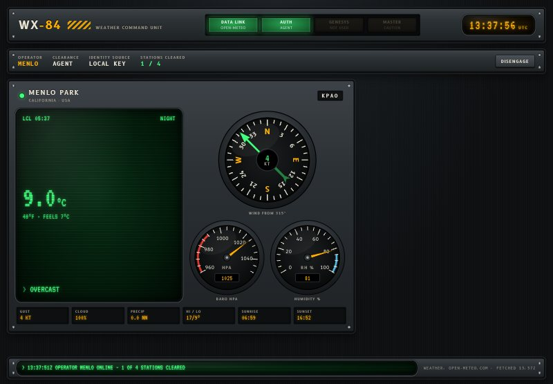
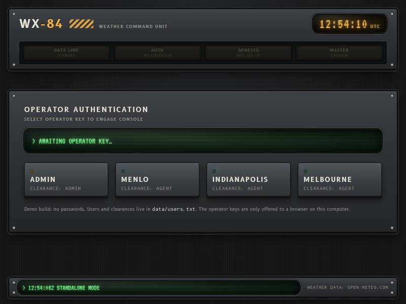
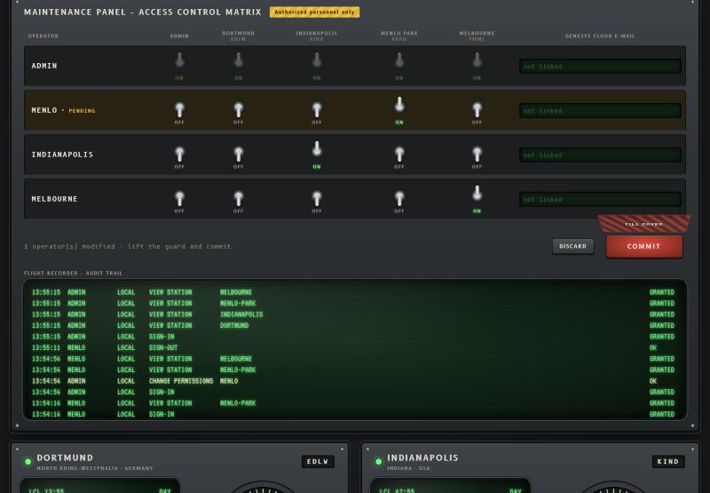
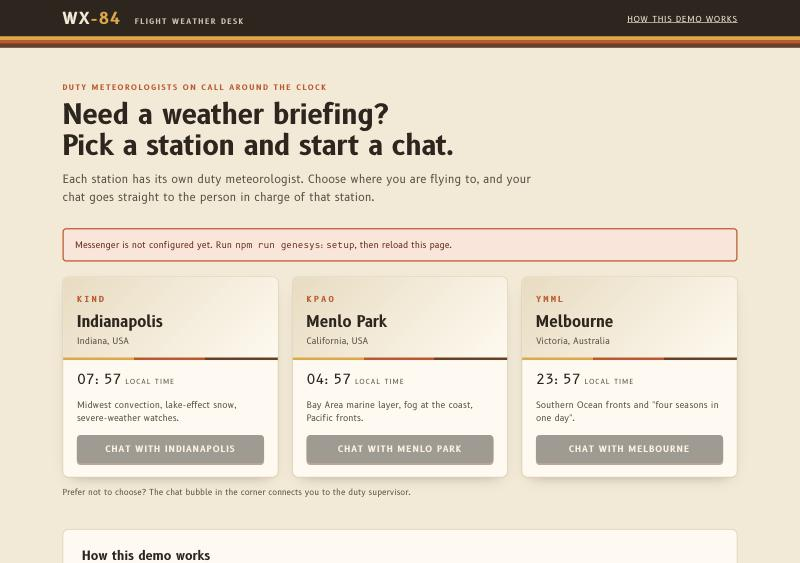
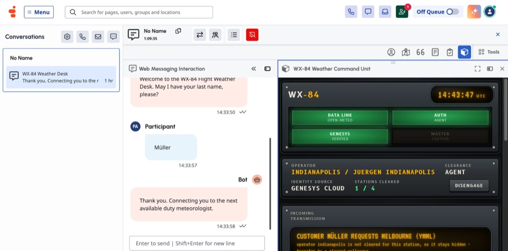

# WX-84 Weather Command Unit

**A Genesys Cloud demo: a third-party tool with its own access management, embedded in the agent desktop. The agent's _verified_ Genesys Cloud identity decides what the tool shows.**



Many contact-center tools have their own users and permissions. Embed such a tool in Genesys Cloud and you face a question: *how does the tool know who the agent is, and how does it stop an agent from seeing data they are not cleared for?* This repository answers that question with a small, complete and deliberately simple example:

| Piece | What it is |
|---|---|
| **WX-84 console** (`public/`, `server/`) | A local web tool styled like a 1980s cockpit. It shows live weather for four stations: Dortmund, Indianapolis, Menlo Park and Melbourne. Four users, four clearances, all stored in **one plain-text file**. |
| **Maintenance panel** | Admins flip toggle switches to grant or revoke stations. Changes apply to open consoles within seconds. Every sign-in, grant, denial and change is logged by the **flight recorder**. |
| **Customer page** (`customer/`) | A "Flight Weather Desk" website. The customer picks a station and starts a Genesys Cloud **Web Messaging** chat. **New conversation** ends the chat and clears it from the browser, for the next demo run. |
| **Genesys Cloud setup** (`genesys/`) | One idempotent script that builds everything in your org: agents, a group, **one queue whose members are that group**, a WebRTC phone per agent, an Architect **inbound message flow** with a name bot, Messenger configuration + deployment, an **OAuth client whose secret only the WX-84 server knows** and the **Interaction Widget**. |

When the chat reaches the agent, the WX-84 console opens inside the interaction and links itself to the agent's Genesys Cloud sign-in, without a window or a click (where the browser allows it; otherwise one click on "Engage link" opens a popup). Every chat goes to the same queue, so any agent of the group may get it. WX-84 verifies the agent with Genesys Cloud and shows only the stations that agent is cleared for; the others are hidden. It also highlights the station the customer asked about, or flags **ACCESS DENIED** if the agent who took the chat is not cleared for it.

> [!IMPORTANT]
> **For partners: one sign-in, not many.** Agents sign in to Genesys Cloud once; an embedded partner app must never ask again. WX-84 achieves that with the production pattern: the **Authorization Code grant with the client secret on the partner's server**, **refresh tokens kept and renewed by the server** (no PKCE parameters, or Genesys sends no refresh token), an **encrypted session store** that survives restarts, and a silent link from the agent desktop that starts only while the panel is visible. The agent links WX-84 once, usually without noticing, and stays linked.
>
> **Read the [partner guide: one sign-in without repeated logins](docs/partner-sso-guide.md)** before you build your integration. It lists the eight traps we hit while building this demo, with the symptom, the cause and the fix.

> **Demo software.** No passwords for the local operator keys, and a text file instead of a database. These are deliberate choices that keep the access-control *logic* readable. See [What this demo does not do](#what-this-demo-intentionally-does-not-do).

## See it explained

Two interactive pages, nothing to install:

* **[System map](https://jtolksdo.github.io/GC-3rdParty-AccessMgmtExample/system-map.html)**: customer chat routing, the agent sign-in and every request on one diagram, with a switch between the demo setup and production.
* **[Agent sign-in, explained](https://jtolksdo.github.io/GC-3rdParty-AccessMgmtExample/agent-sign-in.html)**: for non-developers. How a partner app learns which agent is looking without ever seeing a password, with a gate simulator and a glossary.

Both pages live in [`docs/`](docs/) and are served by GitHub Pages.

---

## Quick start (local only, 1 minute)

Requirements: **Node.js 20+**. There are no npm dependencies.

```bash
git clone <this repo> && cd GC-3rdParty-AccessMgmtExample
npm start
```

| URL | |
|---|---|
| http://localhost:3000 | WX-84 console: pick an operator key (`admin`, `menlo`, `indianapolis`, `melbourne`) |
| http://localhost:3000/customer/ | Customer page (needs the Genesys Cloud setup for the chat itself) |

On first start, `data/users.example.txt` is copied to `data/users.txt`. Edit that file in any text editor, or use the admin's maintenance panel. Changes apply on the next request.



## The permission file

```text
# username | role  | stations                 | genesys e-mail
admin        | admin | *                        |
menlo        | agent | menlo-park               | agent.menlo@your-org.example
indianapolis | agent | indianapolis             | agent.indy@your-org.example
melbourne    | agent | melbourne                | agent.melbourne@your-org.example
```

* `role`: `admin` sees every station and may change permissions. `agent` sees only the listed stations. An unknown role is treated as `agent` (fail closed).
* `stations`: `dortmund`, `indianapolis`, `menlo-park`, `melbourne`, or `*`.
* `genesys e-mail`: links the WX-84 user to a Genesys Cloud user. The setup script fills it in for you. The maintenance panel shows it masked (`j••••••@g••••.com`), also in the flight recorder, so it is safe on a shared screen; a click shows the full address.



## How the access control works

1. **The server decides. The UI only displays.** Weather for a station the user is not cleared for never leaves the server (`GET /api/weather` filters, `GET /api/weather/:id` answers `403`). Hiding the admin panel is cosmetic: every admin API call re-checks clearance.
2. **Sessions remember *who*, never *what*.** A session stores only the username. Clearances are read from `data/users.txt` on every request. That is why a revoked station locks on the agent's screen within seconds, with no re-login.
3. **Two ways to prove identity:**
   * **Local operator key**: password-less, for the demo. It is offered **only to a browser on the same computer** (loopback address, no proxy headers). Through a tunnel or proxy it is disabled.
   * **Genesys Cloud**: OAuth 2.0 **Authorization Code grant with the client secret on the WX-84 server**, started silently in a hidden iframe (only while the panel is visible), with a popup as the fallback. Genesys sends the one-time code to the server's `/auth/callback`, and the server trades it for an access token **and a refresh token**; it renews the access token itself every hour, without the agent. The server verifies the token **itself** via `GET /api/v2/users/me` and `GET /api/v2/tokens/me` against the region in *its own* config. It checks that the token belongs to **your** org (pinned org id) and was issued to the **WX-84 OAuth client** (no tokens from other apps), then maps the Genesys user to a WX-84 user by **exact e-mail** (`server/identity.js`). No match, an unlinked user or two rows with the same e-mail all mean ACCESS DENIED.
4. **The browser never holds a Genesys token.** Only the WX-84 server receives tokens and keeps them in the session ("backend for frontend"); sessions are stored encrypted, so a restart signs nobody out. The server uses it to read the conversation's participant data: the station the customer picked and the last name they gave the chat bot. Because this runs on the *agent's* token, Genesys Cloud decides whether the agent may see the conversation at all, and WX-84 decides what they may see of the weather.
5. **Only Genesys Cloud may frame the console** (`Content-Security-Policy: frame-ancestors`).
6. **Everything is recorded.** Sign-ins, station access (granted *and* denied) and permission changes go to the flight recorder, shown in the maintenance panel and written to `data/flight-recorder.log`.

More detail, including sequence diagrams and the reasoning behind each decision: [docs/architecture.md](docs/architecture.md).

## Genesys Cloud integration



The full step-by-step guide is in [docs/genesys-setup.md](docs/genesys-setup.md). In short:

```bash
# 1. a Client Credentials OAuth client (Master Admin) - secret goes to the macOS keychain
security add-generic-password -s wx84-genesys-setup -a client-id -w
security add-generic-password -s wx84-genesys-setup -a client-secret -w

# 2. who plays the four agents
cp genesys/agents.example.json genesys/agents.json   # then edit the e-mails

# 3. an HTTPS tunnel (Chrome blocks http://localhost inside Genesys Cloud)
cloudflared tunnel --url http://localhost:3000

# 4. build everything in the org
npm run genesys:setup -- --public-url https://<your-tunnel>.trycloudflare.com
```



*In Agent Workspace: the chat on the left, the WX-84 panel (cube icon) on the right. The Indianapolis agent took Müller's request for Melbourne. WX-84 linked itself to the agent's Genesys sign-in, shows only the one station this agent is cleared for, and flags the requested station: Melbourne is not cleared, so it stays hidden.*


The routing: the customer page sets the Web Messaging custom attribute `location` before the first message. The Architect flow [`genesys/flow/wx84-station-router.yaml`](genesys/flow/wx84-station-router.yaml) first calls a small digital bot, [`wx84-name-collector.yaml`](genesys/flow/wx84-name-collector.yaml), which asks the customer for their last name and attaches it as participant data `wx84.lastName`. The console shows it in the incoming banner; it is typed by the customer, so it is a claim, not a verified identity, and WX-84 never stores it. The flow then transfers every chat to one queue, `WX-84 Weather Desk`, whose members are the group `WX-84 Agents`. Any agent of the group may get any chat: the station travels along as context, and the WX-84 console checks whether the agent who took the chat is cleared for it. Stations without clearance stay hidden. Dortmund is the HQ station: the admin sees it, but customers cannot select it.

A ten-minute storyline for presenting the demo: [docs/demo-script.md](docs/demo-script.md).

## Repository layout

```text
server/            Node HTTP server, zero dependencies
  server.js          routes, static files, security headers
  permissions.js     parse / write data/users.txt
  identity.js        Genesys user -> WX-84 user mapping
  genesys.js         server-side token verification
  genesys-auth.js    sign-in with the client secret, refresh tokens, revoke
  sessions.js        sessions (encrypted on disk) + sign-in handoff
  weather.js         Open-Meteo client with offline simulation fallback
  audit.js           flight recorder
public/            the cockpit console (vanilla JS, SVG instruments)
  auth/popup.html    last stop of the sign-in: closes the popup or reports a failed silent link
customer/          customer website with Genesys Messenger
genesys/           provisioning script, Archy flow, agent template
data/              users.example.txt (users.txt + log are created at runtime)
config/            config.example.json (config.json is written by the setup)
docs/              partner sign-in guide, architecture, setup guide, demo script, interactive pages
```

## What this demo intentionally does not do

| Demo shortcut | What you would do in production |
|---|---|
| Plain-text permission file | A database or your IdP's groups/roles, with change history |
| Password-less local sign-in | Remove it, or put it behind real authentication |
| Sessions in an encrypted file on one server (key derived from the client secret) | A shared session store for several servers, with the key from a KMS |
| Client secret in the macOS keychain of the demo Mac | A secrets manager, with rotation |
| `allowAllDomains: true` on the Messenger deployment | List your real website domains |
| Identity mapping by e-mail | Map by immutable Genesys user id, or by Genesys group/role membership |
| HTTPS via a developer tunnel | Proper hosting with your own domain and certificate |

## Credits & license

* The name: *WX* is aviation shorthand for weather, *84* nods to the 1980s cockpit look. WX-84 is a fictional device, not a real product.
* Weather data: [Open-Meteo](https://open-meteo.com) (free for non-commercial use, CC BY 4.0).
* Cockpit fonts: [B612](https://github.com/polarsys/b612) (the open-source Airbus cockpit font) and VT323, via Google Fonts.
* Genesys Cloud APIs: [developer.genesys.cloud](https://developer.genesys.cloud).

MIT License, see [LICENSE](LICENSE). This is a community demo and not an official Genesys product.
