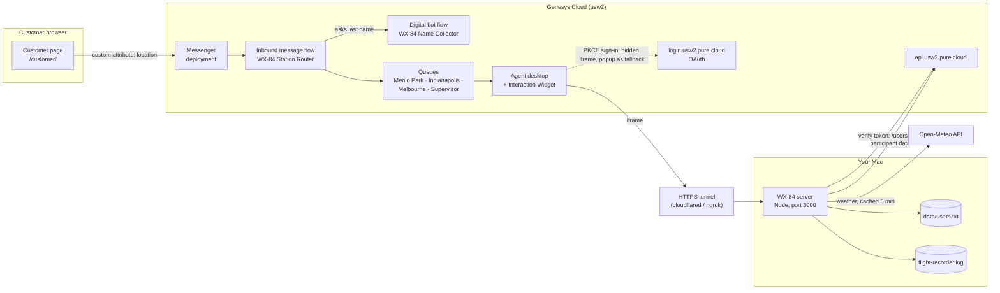

# Architecture & design decisions

## Components



## Embedded sign-in sequence

The Interaction Widget is an iframe on `apps.usw2.pure.cloud`. WX-84 signs in with **Authorization Code + PKCE** (Genesys stopped issuing new *implicit grant* clients in 2026) and tries two ways, in this order:

1. **Silent, in a hidden iframe** (no window, no click). When the agent is signed in to Genesys Cloud, `login.usw2.pure.cloud/oauth/authorize` answers with an immediate redirect carrying the code; its login page is never shown. This needs the browser to send the Genesys login cookie (`SameSite=None`) to an embedded page: Chrome does by default, Safari and incognito windows do not.
2. **Popup, as the fallback** ("Engage link"). If the agent is signed out, Genesys' login page must be shown, and it refuses to be framed (`frame-ancestors 'none'`). The console waits 10 seconds for the silent attempt, or less if the hidden page reports an OAuth error, then offers the popup.

Neither the hidden page nor the popup can hand the result to the console through browser storage: Chrome partitions the console's storage under the top-level site `apps.usw2.pure.cloud`, and if the Genesys login page sends `Cross-Origin-Opener-Policy`, `window.opener` is gone. So the result travels through the WX-84 server under a random, single-use **handoff id** that only the console and its sign-in page know.

```mermaid
sequenceDiagram
  autonumber
  participant W as WX-84 iframe (widget)
  participant P as Sign-in page (auth/popup.html): hidden iframe, popup as fallback
  participant L as login.usw2.pure.cloud
  participant S as WX-84 server
  participant A as api.usw2.pure.cloud

  W->>W: console opens, create random handoff id
  W->>P: hidden iframe /auth/popup.html?silent=1&handoff=… (after a timeout: popup on ENGAGE)
  P->>P: create PKCE verifier + challenge + state (sessionStorage)
  P->>L: /oauth/authorize?response_type=code&code_challenge=…
  L-->>P: redirect ?code=…&state=… (agent already signed in: no prompt)
  P->>L: POST /oauth/token (code + code_verifier)
  L-->>P: access_token
  P->>S: POST /api/session/genesys {accessToken, handoff}
  S->>A: GET /api/v2/users/me?expand=organization + GET /api/v2/tokens/me
  A-->>S: id, name, email, organization.id + issuing OAuth client
  S->>S: pinned org? issued to the WX-84 client? map user (identity.js), create session, park under handoff
  S-->>P: ok (a popup closes itself; the hidden iframe is removed)
  loop every second
    W->>S: GET /api/session/handoff/{id}
  end
  S-->>W: WX-84 session token (single use)
  W->>S: GET /api/me, /api/weather, /api/genesys/conversations/{id}/station
```

## Decisions and trade-offs

| Decision | Why | Alternative considered |
|---|---|---|
| **Server-side filtering** of weather data | The only place you can enforce anything is the server. The UI just reflects the answer. | Hiding panels in the UI: trivially bypassed with dev tools. |
| **Permissions read per request** (file mtime cache) | Revocation is immediate, with no stale clearances in long-lived sessions or tokens. | Permissions baked into a session/JWT: faster, but revocation waits for expiry. |
| **Plain-text file** | Readable by anyone in a demo; diff-able; no install. | SQLite/DB: more realistic, but hides the logic behind tooling. |
| **Atomic writes** (temp file + rename) | A crash never leaves a half-written permission file. | Direct overwrite. |
| **Input validation on `|` and line breaks** | Stops a crafted e-mail from injecting an extra "admin" line into the text file. Every storage format has its own injection risk. | None: the most common file-based bug. |
| **Authorization Code + PKCE** | Implicit grant is deprecated (no new clients in Genesys Cloud since 2026). PKCE needs no client secret in the browser. | Implicit grant; a server-side code flow with a client secret. |
| **Silent sign-in in a hidden iframe, popup as fallback** | Signed-in agents link without a window or a click; everyone else still gets in. | Popup only: robust, but one click and a flashing window every time. Redirecting the whole console: if the login page refuses framing, the console is gone and cannot fall back. |
| **Token must be issued to the WX-84 OAuth client** (`GET /api/v2/tokens/me`) | Stops "token substitution": a valid token another app in the same org obtained for the agent must not open WX-84. | Checking only user and org. |
| **Popup + server handoff** | Works despite iframe storage partitioning and COOP. The session token reaches only the iframe that started the flow. | `postMessage` via `window.opener`: breaks under COOP. `BroadcastChannel`: partitioned. |
| **Token verified by our server** against **our configured region** | The browser could lie. If the verification URL came from the client, an attacker could point it at a fake "Genesys". | Trusting a user id passed in the widget URL: forgeable by anyone. |
| **Pinned org id** | A valid token from *another* Genesys Cloud org must not unlock anything. | Matching by e-mail only. |
| **Genesys token stays on the server** ("backend for frontend") | XSS in the console cannot leak a Genesys token. | Token in localStorage. |
| **Local key only from loopback** | The tunnel makes the console reachable from the internet. Without this check, anyone with the URL could press "admin". | A config flag alone: easy to forget. |
| **Server listens on 127.0.0.1** | Not reachable from the LAN. Only the tunnel (a local process) forwards traffic. | `0.0.0.0`. |
| **`frame-ancestors` limited to Genesys domains** | Clickjacking protection: nobody else can embed the console. | No CSP. |
| **Customer data read with the agent's token** | Genesys Cloud's own permissions decide whether the agent may see the conversation, and with it the customer's last name. Two access models stack: Genesys for customer data, WX-84 for partner data. | A service account: sees every conversation, so the partner app would have to re-implement Genesys' rules. |
| **Customer name: shown, never stored or logged**, and escaped | It is personal data typed by the customer: an unverified claim and untrusted input. The rule for what is shown lives in `server/customer.js`. | Logging it in the flight recorder: personal data in an audit file. |
| **Widget limited to a Genesys group + the WX-84 queues** | Defense in depth: Genesys decides who even *sees* the widget, and WX-84 decides what they see inside it. | Visible to everyone. |
| **Open-Meteo + simulation fallback** | No API key in a public repo; a live demo never shows an empty cockpit. | Keyed weather APIs. |

## API (local server)

| Method & path | Auth | Purpose |
|---|---|---|
| `GET /api/config` | none | Public config (no secrets), stations, sign-in options |
| `GET /api/login-users` | loopback only | Operator keys for the local sign-in |
| `POST /api/session/local` | loopback only | Password-less local sign-in |
| `POST /api/session/genesys` | Genesys token | Verify the token, map the user, create a session (optionally park it under a handoff) |
| `GET /api/session/handoff/:id` | handoff id | Collect a parked sign-in (single use, 2 min) |
| `GET /api/me` | session | Who am I, which stations, permissions version |
| `GET /api/weather` | session | Readings for cleared stations only |
| `GET /api/weather/:station` | session | One station, `403` if not cleared (logged) |
| `GET /api/genesys/conversations/:id/station` | Genesys session | Station the customer picked (participant data `location`) and the last name from the chat bot (`wx84.lastName`, cleaned by `server/customer.js`) |
| `GET /api/admin/users` | admin | Permission matrix |
| `PUT /api/admin/users/:username` | admin | Change role / stations / Genesys e-mail |
| `GET /api/admin/audit` | admin | Flight recorder |
