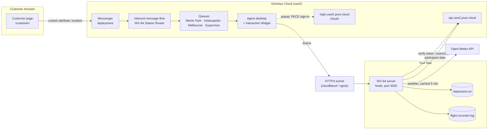
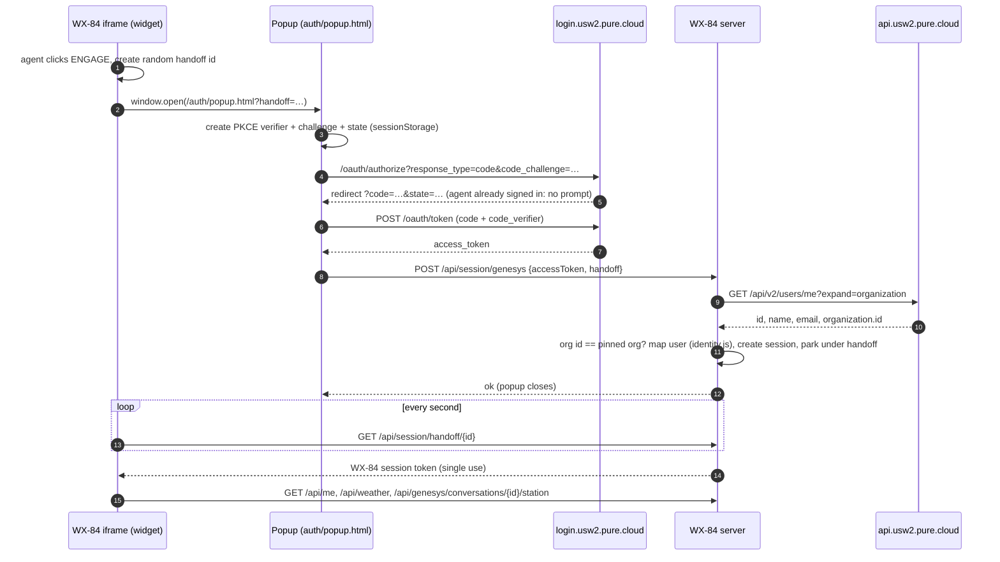

# Architecture & design decisions

## Components

## Embedded sign-in sequence

The Interaction Widget is an iframe on `apps.usw2.pure.cloud`. Signing in inside that iframe is unreliable: identity providers often refuse to be framed, and Genesys stopped issuing new *implicit grant* clients in 2026. WX-84 therefore signs in through a **popup** with **Authorization Code + PKCE**.

The catch: the popup and the iframe cannot talk through browser storage. Chrome partitions the iframe's storage under the top-level site `apps.usw2.pure.cloud`, while the popup is a top-level window on the WX-84 origin. And if the Genesys login page sends `Cross-Origin-Opener-Policy`, `window.opener` is gone too. So the result travels through the WX-84 server under a random, single-use **handoff id** that only the iframe and its popup know.

## Decisions and trade-offs

| Decision | Why | Alternative considered |
|---|---|---|
| **Server-side filtering** of weather data | The only place you can enforce anything is the server. The UI just reflects the answer. | Hiding panels in the UI: trivially bypassed with dev tools. |
| **Permissions read per request** (file mtime cache) | Revocation is immediate, with no stale clearances in long-lived sessions or tokens. | Permissions baked into a session/JWT: faster, but revocation waits for expiry. |
| **Plain-text file** | Readable by anyone in a demo; diff-able; no install. | SQLite/DB: more realistic, but hides the logic behind tooling. |
| **Atomic writes** (temp file + rename) | A crash never leaves a half-written permission file. | Direct overwrite. |
| **Input validation on `|` and line breaks** | Stops a crafted e-mail from injecting an extra "admin" line into the text file. Every storage format has its own injection risk. | None: the most common file-based bug. |
| **Authorization Code + PKCE** | Implicit grant is deprecated (no new clients in Genesys Cloud since 2026). PKCE needs no client secret in the browser. | Implicit grant; a server-side code flow with a client secret. |
| **Popup + server handoff** | Works despite iframe storage partitioning and COOP. The session token reaches only the iframe that started the flow. | `postMessage` via `window.opener`: breaks under COOP. `BroadcastChannel`: partitioned. |
| **Token verified by our server** against **our configured region** | The browser could lie. If the verification URL came from the client, an attacker could point it at a fake "Genesys". | Trusting a user id passed in the widget URL: forgeable by anyone. |
| **Pinned org id** | A valid token from *another* Genesys Cloud org must not unlock anything. | Matching by e-mail only. |
| **Genesys token stays on the server** ("backend for frontend") | XSS in the console cannot leak a Genesys token. | Token in localStorage. |
| **Local key only from loopback** | The tunnel makes the console reachable from the internet. Without this check, anyone with the URL could press "admin". | A config flag alone: easy to forget. |
| **Server listens on 127.0.0.1** | Not reachable from the LAN. Only the tunnel (a local process) forwards traffic. | `0.0.0.0`. |
| **`frame-ancestors` limited to Genesys domains** | Clickjacking protection: nobody else can embed the console. | No CSP. |
| **Widget limited to a Genesys group + the WX-84 queues** | Defense in depth: Genesys decides who even *sees* the widget, and WX-84 decides what they see inside it. | Visible to everyone. |
| **Open-Meteo + simulation fallback** | No API key in a public repo; a live demo never shows an empty cockpit. | Keyed weather APIs. |

## API (local server)

| Method & path | Auth | Purpose |
|---|---|---|
| `GET /api/config` | none | Public config (no secrets), stations, sign-in options |
| `GET /api/login-users` | loopback only | Operator keys for the local sign-in |
| `POST /api/session/local` | loopback only | Password-less local sign-in |
| `POST /api/session/genesys` | Genesys token | Verify the token, map the user, create a session (optionally park it under a handoff) |
| `GET /api/session/handoff/:id` | handoff id | Collect a parked sign-in (single use, 2 min) |
| `GET /api/me` | session | Who am I, which stations, permissions version |
| `GET /api/weather` | session | Readings for cleared stations only |
| `GET /api/weather/:station` | session | One station, `403` if not cleared (logged) |
| `GET /api/genesys/conversations/:id/station` | Genesys session | Station the customer picked (participant data `location`) |
| `GET /api/admin/users` | admin | Permission matrix |
| `PUT /api/admin/users/:username` | admin | Change role / stations / Genesys e-mail |
| `GET /api/admin/audit` | admin | Flight recorder |
