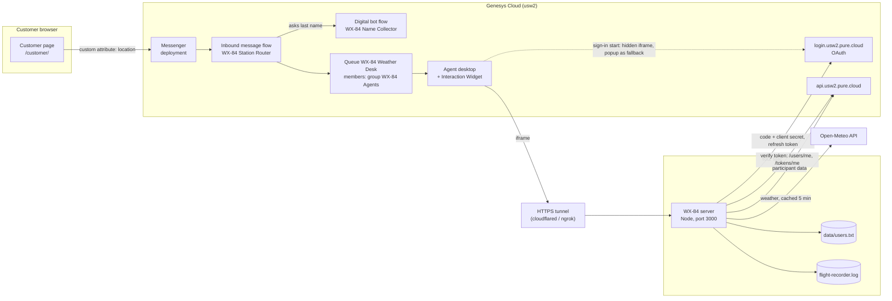

# Architecture & design decisions

## Components



## Embedded sign-in sequence

> Partners: the reasoning behind this design, and the traps it avoids, are in the [partner guide](partner-sso-guide.md).

The Interaction Widget is an iframe on `apps.usw2.pure.cloud`. WX-84 signs agents in with the **Authorization Code grant and the client secret on the WX-84 server** ("backend for frontend"). The browser only carries the one-time code; the server receives the access token **and a refresh token**, and renews the access token itself every hour, without the agent and without the agent's Genesys login session. No PKCE parameters: with a `code_challenge`, Genesys issues no refresh token.

The browser starts the sign-in at the server's `/auth/start` in one of two ways:

1. **Silent, in a hidden iframe** (no window, no click), started only while the panel is visible. When the agent is signed in to Genesys Cloud, `login.usw2.pure.cloud/oauth/authorize` answers with an immediate redirect carrying the code; its login page is never shown. This needs the browser to send the Genesys login cookie (`SameSite=None`) to an embedded page: Chrome does by default, Safari and incognito windows do not.
2. **Popup, as the fallback** ("Engage link"). If the agent's Genesys login session has ended, Genesys' login page must be shown, and it refuses to be framed (`frame-ancestors 'none'`). The console waits 10 seconds for the silent attempt, or less if it reports an error, then offers the popup, and retries silently once when the agent returns to the window.

Neither the hidden iframe nor the popup can hand the result to the console through browser storage: Chrome partitions the console's storage under the top-level site `apps.usw2.pure.cloud`, and if the Genesys login page sends `Cross-Origin-Opener-Policy`, `window.opener` is gone. So the result travels through the WX-84 server under a random, single-use **handoff id** that only the console knows.

```mermaid
sequenceDiagram
  autonumber
  participant W as WX-84 console (widget iframe)
  participant F as Hidden iframe or popup
  participant S as WX-84 server
  participant L as login.usw2.pure.cloud
  participant A as api.usw2.pure.cloud

  W->>W: console opens (visible), create random handoff id
  W->>F: hidden iframe /auth/start?silent=1&handoff=… (popup on ENGAGE)
  F->>S: GET /auth/start
  S-->>F: 302 /oauth/authorize?response_type=code&state=… (state kept on the server, single use; no PKCE)
  F->>L: /oauth/authorize
  L-->>F: 302 /auth/callback?code=…&state=… (agent signed in: no prompt)
  F->>S: GET /auth/callback
  S->>L: POST /oauth/token (code, Basic client_id:client_secret)
  L-->>S: access_token (1 h) + refresh_token
  S->>A: GET /api/v2/users/me?expand=organization + GET /api/v2/tokens/me
  A-->>S: id, name, email, organization.id + issuing OAuth client
  S->>S: pinned org? issued to the WX-84 client? map user, create session (stored encrypted), park under handoff
  S-->>F: 302 /auth/popup.html?status=ok (a popup closes itself)
  loop every second
    W->>S: GET /api/session/handoff/{id}
  end
  S-->>W: WX-84 session token (single use)
  W->>S: GET /api/me, /api/weather, /api/genesys/conversations/{id}/station
  loop every hour, in the background
    S->>L: POST /oauth/token (grant_type=refresh_token, Basic auth)
    L-->>S: new access_token + new refresh_token
  end
```

## Decisions and trade-offs

| Decision | Why | Alternative considered |
|---|---|---|
| **Server-side filtering** of weather data | The only place you can enforce anything is the server. The UI just reflects the answer. | Hiding panels in the UI: trivially bypassed with dev tools. |
| **Permissions read per request** (file mtime cache) | Revocation is immediate, with no stale clearances in long-lived sessions or tokens. | Permissions baked into a session/JWT: faster, but revocation waits for expiry. |
| **Plain-text file** | Readable by anyone in a demo; diff-able; no install. | SQLite/DB: more realistic, but hides the logic behind tooling. |
| **Atomic writes** (temp file + rename) | A crash never leaves a half-written permission file. | Direct overwrite. |
| **Input validation on `|` and line breaks** | Stops a crafted e-mail from injecting an extra "admin" line into the text file. Every storage format has its own injection risk. | None: the most common file-based bug. |
| **Authorization Code grant with the client secret on the server, refresh tokens** | Only this grant gets refresh tokens from Genesys, and only refresh tokens let the server renew access without the agent's Genesys login session. That is what removes repeated sign-ins. The browser never sees a token. | PKCE in the browser (the first version of this demo): no refresh token, so the popup returned every hour. Implicit grant: no new clients since 2026. |
| **No PKCE parameters in the server-side flow** | With a `code_challenge`, Genesys treats the sign-in as PKCE and sends no refresh token (tested). The code is still protected: redeemable only with the client secret, only at the registered callback, tied to a one-time `state` kept on the server. | PKCE plus secret (OAuth 2.1 recommendation): costs the refresh token, and with it the whole point. |
| **Sessions stored encrypted** (AES-256-GCM, key derived from the client secret; 12 h idle, 7 days at most) | Restarts and deployments sign nobody out; refresh tokens are credentials and must not sit in plain text. | In-memory sessions: every restart meant a new sign-in for every agent. |
| **Silent sign-in in a hidden iframe, started only while visible; popup as fallback** | Signed-in agents link without a window or a click; everyone else still gets in. Chrome throttles background timers, so a silent attempt started in a background window times out. | Popup only: robust, but one click and a flashing window every time. Redirecting the whole console: if the login page refuses framing, the console is gone and cannot fall back. |
| **Token must be issued to the WX-84 OAuth client** (`GET /api/v2/tokens/me`) | Stops "token substitution": a valid token another app in the same org obtained for the agent must not open WX-84. | Checking only user and org. |
| **Popup + server handoff** | Works despite iframe storage partitioning and COOP. The session token reaches only the iframe that started the flow. | `postMessage` via `window.opener`: breaks under COOP. `BroadcastChannel`: partitioned. |
| **Token verified by our server** against **our configured region** | The browser could lie. If the verification URL came from the client, an attacker could point it at a fake "Genesys". | Trusting a user id passed in the widget URL: forgeable by anyone. |
| **Pinned org id** | A valid token from *another* Genesys Cloud org must not unlock anything. | Matching by e-mail only. |
| **Genesys token stays on the server** ("backend for frontend") | XSS in the console cannot leak a Genesys token. | Token in localStorage. |
| **Local key only from loopback** | The tunnel makes the console reachable from the internet. Without this check, anyone with the URL could press "admin". | A config flag alone: easy to forget. |
| **Server listens on 127.0.0.1** | Not reachable from the LAN. Only the tunnel (a local process) forwards traffic. | `0.0.0.0`. |
| **`frame-ancestors` limited to Genesys domains** | Clickjacking protection: nobody else can embed the console. | No CSP. |
| **Customer data read with the agent's token** | Genesys Cloud's own permissions decide whether the agent may see the conversation, and with it the customer's last name. Two access models stack: Genesys for customer data, WX-84 for partner data. | A service account: sees every conversation, so the partner app would have to re-implement Genesys' rules. |
| **Customer name: shown, never stored or logged**, and escaped | It is personal data typed by the customer: an unverified claim and untrusted input. The rule for what is shown lives in `server/customer.js`. | Logging it in the flight recorder: personal data in an audit file. |
| **Widget limited to a Genesys group + the WX-84 Weather Desk queue** | Defense in depth: Genesys decides who even *sees* the widget, and WX-84 decides what they see inside it. | Visible to everyone. |
| **One queue for the whole group; the station is context, not a route** | Any agent may get any chat, so the partner app has to decide per agent what to show: the realistic case for a shared team. Genesys stays simple: one queue, membership follows the group. | A queue per station: the right agent always gets the right chat, so the partner's access control is never put to the test. |
| **Stations without clearance are hidden** | Less clutter: the agent sees only what they may use. Purely cosmetic, because the server already refuses data for those stations. | Locked panels with hazard plates: shows the access model, but clutters the console. |
| **Open-Meteo + simulation fallback** | No API key in a public repo; a live demo never shows an empty cockpit. | Keyed weather APIs. |

## API (local server)

| Method & path | Auth | Purpose |
|---|---|---|
| `GET /api/config` | none | Public config (no secrets), stations, sign-in options |
| `GET /api/login-users` | loopback only | Operator keys for the local sign-in |
| `POST /api/session/local` | loopback only | Password-less local sign-in |
| `GET /auth/start` | handoff id | Start a Genesys sign-in (hidden iframe or popup): redirect to Genesys authorize with a one-time state |
| `GET /auth/callback` | one-time state | Genesys returns here: trade the code for tokens with the client secret, verify, map, create the session, park it under the handoff |
| `GET /api/session/handoff/:id` | handoff id | Collect a parked sign-in (single use, 2 min) |
| `GET /api/me` | session | Who am I, which stations, permissions version |
| `GET /api/weather` | session | Readings for cleared stations only |
| `GET /api/weather/:station` | session | One station, `403` if not cleared (logged) |
| `GET /api/genesys/conversations/:id/station` | Genesys session | Station the customer picked (participant data `location`) and the last name from the chat bot (`wx84.lastName`, cleaned by `server/customer.js`) |
| `GET /api/admin/users` | admin | Permission matrix |
| `PUT /api/admin/users/:username` | admin | Change role / stations / Genesys e-mail |
| `GET /api/admin/audit` | admin | Flight recorder |
