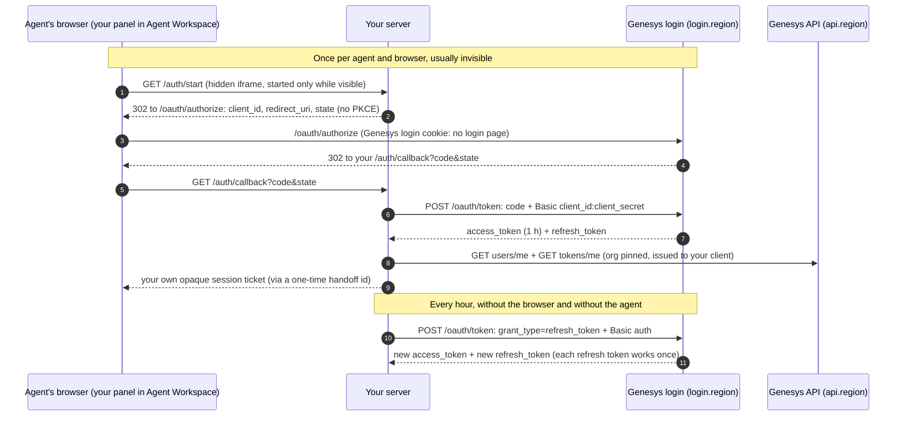

# One sign-in: embedding a partner app in Genesys Cloud without repeated logins

**For partners and their engineers.** Agents sign in to Genesys Cloud once at the start of their shift. A partner app that lives inside the agent desktop must not ask them again: not after an hour, not after the partner deploys a new version, not because the browser window was in the background. Customers and partners rightly reject anything else.

This guide shows the pattern that achieves that, why simpler patterns fail, and where WX-84 implements each piece. Everything here was built and tested against a live Genesys Cloud org (usw2) on 2026-11-26.

## The short version

1. **Let your server do the sign-in.** Use the OAuth **Authorization Code grant with your client secret on your server**. The browser only carries a one-time code; it never sees a token.
2. **Keep the refresh token on your server and renew access yourself.** Genesys issues a refresh token with this grant. Your server trades it for a new access token before the old one expires: no agent, no browser, no Genesys login session needed.
3. **Do not send PKCE parameters in this flow.** With a `code_challenge` in the authorize request, Genesys treats the sign-in as a PKCE flow and **issues no refresh token**. (Tested.)
4. **Keep sessions in a persistent, encrypted store,** so a restart or deployment does not sign every agent out.
5. **Link silently from the agent desktop, only while the page is visible,** and fall back to a one-click popup.

Result: an agent links your app **once**, usually without noticing. After that the link holds for as long as the agent keeps working, across hours, restarts and background windows.

## The pattern



## What to build

### In Genesys Cloud (per customer org)

| What | Setting | Why |
|---|---|---|
| OAuth client | Grant type **Code** (Authorization Code); scopes **read-only** and minimal; token lifetime **1 hour**; redirect URI **exactly** your server's callback | Short tokens are cheap once your server refreshes them. An exact redirect URI means only your server can receive the code |
| Client secret | Stored in your secrets manager, never in a browser, a repo or a log | The secret is what makes the code worthless to anyone but your server, and what Genesys requires for refresh tokens |
| Interaction Widget | URL of your app, limited to the right group and queues | Genesys decides who even sees the panel |
| Default panel | Admin > Contact Center > **Panel Manager**: your Interaction Widget as the default for the interaction types it serves; agents need *Agent UI > Default Panels > View* | Otherwise every interaction opens with *Profile*, and the agent has to look for your app. Panel Manager has no public API: plan it as one manual step in your installation guide (the permission can be granted by API, through a role) |

### On your server

1. **`/auth/start`**: create a random one-time `state`, remember it for a few minutes (with the handoff id of the panel that asked), and redirect to `https://login.<region>/oauth/authorize` with `client_id`, `response_type=code`, `redirect_uri`, `state`. **No `code_challenge`.**
2. **`/auth/callback`**: accept only a known, unused `state`. Exchange the code at `/oauth/token` with HTTP Basic `client_id:client_secret`. You receive `access_token`, `refresh_token` and `expires_in`.
3. **Verify, do not trust**: `GET /api/v2/users/me?expand=organization` (pin the customer's org id) and `GET /api/v2/tokens/me` (the token must be issued to **your** OAuth client, or a token from another app in the same org could open yours).
4. **Map** the Genesys user to your own user. Production: by the immutable Genesys **user id**, or by Genesys group membership.
5. **Hand the browser only your own session ticket.** Keep the Genesys tokens on the server ("backend for frontend").
6. **Renew** before the access token expires: `POST /oauth/token` with `grant_type=refresh_token`, same Basic auth. **Store the new refresh token every time**; each one works once. If Genesys refuses (refresh token expired or revoked, agent deactivated), end the session: the panel relinks.
7. **Persist sessions** in a shared store with the tokens encrypted at rest (database or cache plus a key from your KMS). Deployments and restarts must not sign anyone out.
8. **Sign-out** revokes your token: `DELETE /api/v2/tokens/me`. The agent desktop's own token is not affected.

### In the browser (your panel)

1. On load, start the silent sign-in in a **hidden iframe** pointing to your `/auth/start`, **only when `document.visibilityState` is `visible`**, with a short time budget (about 10 seconds).
2. Pass the result through your server under a **one-time handoff id**: the panel polls for it. The iframe, a popup and your panel cannot share browser storage inside Agent Workspace (storage partitioning).
3. If the silent attempt fails, show **one** button that opens the same `/auth/start` in a **popup**. Retry silently once when the agent comes back to the window.
4. When your API answers `401`, relink automatically (silently first). Never leave the agent at an error message.

## The traps we hit, and how this pattern avoids them

| Symptom the agent saw | Cause | Fix in this pattern |
|---|---|---|
| A popup asks for the **Genesys password** although the agent is signed in | Genesys has **two** sessions: Agent Workspace keeps its own token; the **login session** at `login.<region>` (which other apps use to get a token without a password) can end after about an hour | Needed only for the first link. Afterwards your server renews with the refresh token and never needs the login session again |
| **"Conversation lookup failed"** after an hour | The app's session outlived the 1-hour Genesys token it relied on | Server-side refresh before expiry. Rule: a session must never outlive its credential |
| **"Auto-link not available"** in Safari, incognito or a locked-down Chrome | The browser does not send the Genesys login cookie to embedded pages (third-party cookies blocked); Genesys' login page refuses to be framed | One-click popup for the first link. With refresh tokens it stays a one-time event |
| **"Auto-link not available"** although nothing was wrong | The silent sign-in started while the window was in the background; Chrome throttles background timers to about once a minute, so it timed out | Start the silent sign-in only while the page is visible; check again when the agent returns |
| **Every agent signs in again** after a restart or deployment | Sessions lived only in server memory | Persistent, encrypted session store |
| The silent attempt always takes the full timeout when it cannot work | Genesys **ignores `prompt=none`**: without a login session it shows its login page instead of answering `login_required` | Keep the timeout short and fall back to the popup |
| **No refresh token** despite the client secret | The authorize request carried a PKCE `code_challenge`; Genesys then treats it as a PKCE flow | No PKCE parameters in the server-side Code flow (see security notes) |
| The panel is **missing** after the widget was changed | Agent Workspace loads widget configuration at sign-in | Reload the agent desktop after widget changes |
| Every chat opens with **Profile**, not with your app | No default panel set, or agents lack *Agent UI > Default Panels > View* | Panel Manager (once, by hand) plus the permission through a role |

## When does an agent still see a login?

Be honest with customers about this list. It is short:

* **The very first link** in a browser profile, if the agent's Genesys login session has already ended (for example, the desktop has been open for hours). One popup, once.
* **Browsers that block third-party cookies** (Safari, private windows, some managed Chrome policies): the first link needs one click on the popup button.
* **Genesys refuses a refresh**: the agent was deactivated, the client secret was rotated, or the refresh token expired or was revoked. That is the moment access *should* end.
* **Your own session policy** ends the session (WX-84: 12 hours without use, 7 days at most). Choose what your customers need.

Everything else (hours of work, background windows, restarts, deployments) needs **no** login.

## Security notes

* **Client secret**: only on your server, in a secrets manager. WX-84 keeps it in the macOS keychain; it is never in a file, the repo or a log.
* **Refresh tokens are credentials.** Encrypt them at rest, store the rotated token after every refresh, revoke on sign-out. WX-84 encrypts its session file with AES-256-GCM, with a key derived from the client secret.
* **Why no PKCE in this flow, and why that is acceptable.** PKCE protects a code that could be intercepted and redeemed by someone else. Here the code can only be redeemed with your client secret, only at your exact redirect URI, and the one-time `state` ties it to the request your server started. Genesys issues no refresh token when PKCE parameters are present, and without refresh tokens there is no way to avoid repeated logins.
* **Token substitution**: always check `tokens/me` → `OAuthClient.id` equals your client. A valid token another app obtained for the same agent must not open yours.
* **Pin the org**: a valid token from another Genesys Cloud customer must not open your app.
* **Least privilege**: read-only scopes. A Genesys token never allows more than the agent's own roles.
* **Authorization stays yours**: Genesys proves *who* the agent is. *What* the agent may see in your app is decided by your server, on every request.

## How WX-84 implements it

| Piece | Where |
|---|---|
| Authorize URL, code exchange, refresh, revoke, client secret lookup | [`server/genesys-auth.js`](../server/genesys-auth.js) |
| `/auth/start`, `/auth/callback`, token renewal (background loop and on demand), relink on refusal | [`server/server.js`](../server/server.js) |
| Session lifetime (12 h idle, 7 days absolute), encrypted persistence | [`server/sessions.js`](../server/sessions.js) |
| Hidden iframe, popup, one-time handoff | [`public/js/genesys-link.js`](../public/js/genesys-link.js) |
| Silent sign-in only while visible, relink on 401 | [`public/js/app.js`](../public/js/app.js) |
| OAuth client (Code, 1 h, callback URIs), client secret into the keychain (checked with Genesys, regenerated only when missing or rejected) | [`genesys/setup.js`](../genesys/setup.js) |

To watch the renewal without waiting an hour, start the server with `WX84_GENESYS_TOKEN_MAX_AGE_SECONDS=120` (launch configuration `wx84-fast-refresh`): the flight recorder shows `TOKEN REFRESH OK` every two to three minutes.

## Evidence from the live test (2026-11-26, UTC)

```text
16:09:30  SIGN-IN        GRANTED  ... - Genesys sent no refresh token     (authorize request still carried PKCE)
16:26:48  TOKEN REFRESH  FAILED   Genesys issued no refresh token         (server ends that session in time)
16:26:53  SIGN-IN        GRANTED                                          (panel relinked by itself, PKCE removed)
16:29:49  TOKEN REFRESH  OK                                               (server renews, no agent involved)
16:32:49  TOKEN REFRESH  OK
16:33:20  server restarted; 1 session restored from the encrypted file   (no new sign-in follows)
16:35:18  TOKEN REFRESH  OK                                               (the stored refresh token still works)
```

(Test mode: tokens renewed every two minutes instead of every hour.)

## Questions customers and executives ask

| Question | Answer |
|---|---|
| "Why can't the partner app just use the agent desktop's token?" | Agent Workspace does not hand its token to embedded apps, by design. Each app gets its own token for its own OAuth client, with its own scopes, which Genesys can revoke independently. |
| "Why not one service account for the partner app?" | A service account proves which *app* is calling, not which *agent* is looking. It would also see every conversation, so the partner would have to re-implement Genesys' permissions. |
| "Does the customer's IT department have to do anything?" | No identity-provider work. A Genesys Cloud admin creates the OAuth client and the Interaction Widget (or the partner's installer does it). |
| "How often does an agent have to sign in to the partner app?" | Normally never: the first link happens silently because the agent just signed in to Genesys. At most one click in browsers that block third-party cookies. |
| "What if an agent leaves the company?" | Genesys deactivates the user, the next token renewal is refused, and the partner app ends the session within the hour. |
